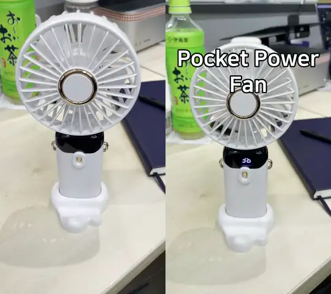
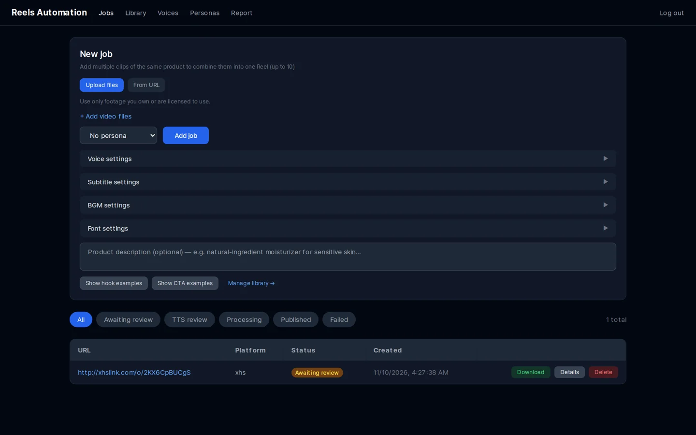
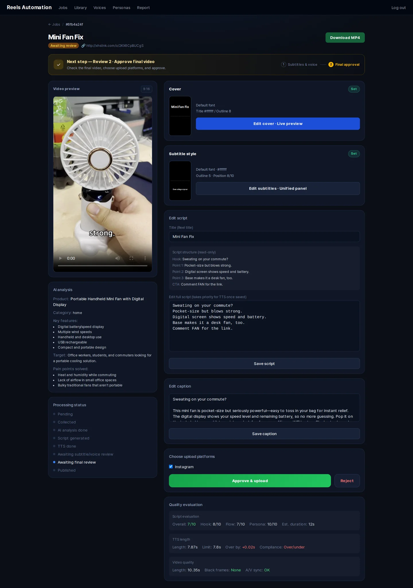

# reels-automation

[English](README.md) · [한국어](README.ko.md) · [简体中文](README.zh-CN.md) · **日本語**

**自分で撮影した製品映像**から、AI が書いたナレーション台本、音声合成（TTS）ナレーション、
スタイル付き字幕、カバー画像を備えた縦型ショート動画（Instagram リール）を作成する、
セルフホスト型のパイプラインです。公開前に、すべての内容を Web ダッシュボードで確認できます。

```
Upload footage ─▶ Gemini video analysis ─▶ GPT script ─▶ ElevenLabs TTS ─▶ 540p preview
      │                                                                        │
      │                                   review: edit script, pick cover ◀────┘
      ▼
1080×1920 final render (subtitles, cover, BGM) ─▶ review & approve ─▶ Instagram Reels
```

> [!IMPORTANT]
> 本プロジェクトは、**自身が所有する、または利用許諾を得ている映像・音声**から動画を作成するための
> ワークフローツールです。他のクリエイターのコンテンツをダウンロード・再アップロード・再収益化する
> 目的のものではなく、そのような用途に使用してはなりません。サードパーティのプラットフォームに
> アクセスする連携機能は**デフォルトで無効**です。いずれかを有効にする前に
> [docs/LEGAL.ja.md](docs/LEGAL.ja.md) をお読みください。

## デモ

10 秒のハンディファンの動画を入れると、リールが出来上がります。ペルソナなし・デフォルト設定で、字幕と
表紙のスタイルだけ調整しています。

<p align="center">
  
</p>
<p align="center"><sub>左：元の素材（メンテナー自身が撮影） · 右：生成されたリール — 表紙、AI 台本、ElevenLabs ナレーション、字幕。<br>▶ <b>音声付きで見る：</b> <i>（動画リンクは近日追加）</i></sub></p>

Gemini が動画を分析し、GPT が書いた台本です（出力言語：英語）。

> **Hook:** Hot commute? Fix it fast.
> **Points:** LED shows speed and battery. · Hold, fold for desk, or wear it. · Strong breeze, quiet, lasts longer.
> **CTA:** Comment FAN for the link.

<details>
<summary>ダッシュボードのスクリーンショット</summary>




</details>

## 機能

- **1 ジョブで複数ソースに対応** — 同じ製品のクリップを最大 10 本まで組み合わせて 1 本の動画にできます。
- **AI 台本** — フック → 3 つの要点 → CTA（行動喚起）の構成で、映像の長さに合わせて任意の言語
  （`CONTENT_LANGUAGE`）で生成します。
- **ペルソナ（任意）** — ダッシュボードで話し方のスタイル（説明＋話法）を定義できます。
  選択しない限りペルソナは適用されません。ペルソナの例は [`examples/`](examples) にあります。
- **プロンプトライブラリ** — フック／CTA／台本の例を保存し、few-shot 例として挿入します。
- **TTS** — ElevenLabs `eleven_v3` を使用し、ジョブごとに音声・速度・音量を設定できます。
- **編集** — moviepy + ffmpeg による字幕（フォント、サイズ、色、縁取り、影、斜体、位置）、
  タイトル付きカバー画像、音量調整可能な BGM。
- **2 段階のレビュー** — 台本編集とカバー選択を行うプレビュー（540p）と、アップロード前の
  最終レンダリング（1080×1920）の確認。
- **品質評価** — 処理を止めないチェック：LLM-as-judge による台本スコア、TTS の長さチェック、
  最終動画の黒フレーム／尺のチェック。
- **Instagram リールへのアップロード** — 公式 Instagram API（Instagram ログイン）を使用します。

## 必要なもの

- Docker（Compose v2）
- API キー：

| サービス | 用途 | 必須 |
|---|---|---|
| [OpenAI](https://platform.openai.com/api-keys) | 台本、キャプション、台本評価 | はい |
| [ElevenLabs](https://elevenlabs.io/app/settings/api-keys) | 音声合成 | はい |
| [Google AI Studio (Gemini)](https://aistudio.google.com/app/apikey) | 動画解析 | 任意 |
| [Meta for Developers](https://developers.facebook.com) | Instagram リールへのアップロード | 任意 |

ElevenLabs の音声を商用利用するには、ElevenLabs の有料プランが必要です。Gemini の無料枠では、
Google が製品改善のために入力内容を利用し、人間がそれを確認する場合があります。詳しくは
[docs/LEGAL.ja.md](docs/LEGAL.ja.md#aiプロバイダー) を参照してください。

## クイックスタート

```bash
git clone https://github.com/lazyflog/reels-automation-oss.git
cd reels-automation-oss
cp .env.example .env          # OPENAI_API_KEY、ELEVENLABS_API_KEY などを記入
python3 scripts/check_env.py  # 任意：.env を検証

docker compose up -d --build
docker compose exec api alembic upgrade head
docker compose exec api python scripts/create_admin.py --username admin --password '<strong password>'

# 任意：ペルソナと ElevenLabs 音声のサンプルを読み込む
docker compose exec api python -m scripts.seed_examples /examples/seed.en.json
```

<http://localhost:8080>（nginx）でダッシュボードを開き、サインインします。

サービス構成：`api`（FastAPI）、`worker` と `beat`（Celery）、`dashboard`（Next.js）、`postgres`、
`redis`、`nginx`。

### Instagram へのアップロード

Instagram はレンダリング済み動画を公開 URL からダウンロードするため、`PUBLIC_BASE_URL` は
nginx（ポート 8080）に到達できる HTTPS アドレスである必要があります。ローカル開発では、
例えば `ngrok http 8080` を使用します。長期トークンは `backend/scripts/instagram_setup.py`
で取得できます（`--help` を参照）。

Meta は、リアルな AI 生成音声（AI ナレーションなど）に AI コンテンツであることを示すラベルを
付けるよう求めています。必要な場合はラベルを付けてください。Content Publishing API には
レート制限があります（1 アカウントあたり 24 時間で約 100 件の投稿）。

## 設定

すべての設定は `.env` にあります。全項目は [`.env.example`](.env.example) を参照してください。

| 変数 | デフォルト | 説明 |
|---|---|---|
| `CONTENT_LANGUAGE` | `English` | 台本、キャプション、カバータイトルの言語 |
| `TARGET_AUDIENCE` | *（空）* | 台本プロンプト用のターゲット層の説明（任意） |
| `CAPTION_DISCLOSURE` | *（空）* | すべてのキャプション末尾に追加するテキスト（例：アフィリエイト表記） |
| `OPENAI_MODEL` / `GEMINI_MODEL` | `gpt-5.2` / `gemini-3-flash-preview` | 使用するモデル |
| `ENABLE_URL_IMPORT` | `true` | URL からのソース動画取り込みを許可（yt-dlp） |
| `UPLOAD_DELAY_MIN_MINUTES` / `…_MAX_MINUTES` | `0` / `0` | アップロード前のランダムな待機時間（任意） |

### オプトイン機能（デフォルトで無効）

以下の機能は必要な権利を持つユーザー向けに用意されていますが、法的リスクや利用規約上のリスクを
伴います。有効にすると、起動時にそれぞれ警告がログに出力されます。**まず
[docs/LEGAL.ja.md](docs/LEGAL.ja.md) をお読みください。**

| 変数 | 機能 | 無効にしている理由 |
|---|---|---|
| `ENABLE_XHS_IMPORT` | サードパーティ製の [XHS-Downloader](https://github.com/JoeanAmier/XHS-Downloader) サイドカー（`docker compose --profile xhs up -d`）を介して小紅書（Xiaohongshu）のリンクを取り込みます。 | 小紅書の規約はスクレイピングとダウンロードを禁止しています。XHS-Downloader（GPL-3.0）にも独自の利用制限があります。 |
| `ENABLE_BGM_URL_DOWNLOAD` | yt-dlp で URL から BGM をダウンロードします。 | YouTube、SoundCloud をはじめ、ほとんどのプラットフォームは音声のダウンロードを禁止しています。 |
| `ENABLE_CLOVA_VOICE` | NAVER CLOVA Voice を TTS プロバイダー／フォールバックとして使用します。 | CLOVA Voice の利用ポリシーは、生成音声の保存・編集を認めていません。 |

## パイプラインの拡張

台本を作成する前にソース動画を処理したい場合（例えば、自身の映像の整理や高画質化）は、
`analyze` と `generate` の間に Celery タスクを追加してください。手順は
[docs/EXTENDING.ja.md](docs/EXTENDING.ja.md) で説明しています。vmake.ai CLI（動画のウォーターマーク／
字幕除去、高画質化など）を使った例も載せています。

## フォントと音楽

本リポジトリにはフォントや音楽ファイルは含まれていません。Docker イメージには Nanum と
Noto CJK のフォントファミリー（SIL OFL 1.1）がインストールされます。追加の `.ttf` / `.otf`
ファイルは `backend/fonts/` に、音声ファイルは `bgm/` に配置してください（ダッシュボードから
アップロードすることもできます）。その際はライセンスを必ず確認してください。おすすめの無料
フォントと音楽の入手先は [docs/ASSETS.ja.md](docs/ASSETS.ja.md) を参照してください。

## プロジェクト構成

```
backend/            FastAPI アプリ、Celery ワーカー、SQLAlchemy モデル、Alembic マイグレーション
  workers/          extract → analyze → generate → tts → edit → upload
  prompts.py        すべての LLM プロンプト（英語。出力言語は設定可能）
dashboard/          Next.js 14 ダッシュボード（App Router、Tailwind）
examples/           シードデータ（ペルソナ、音声）のサンプル（任意、英語・韓国語）
nginx/              リバースプロキシ設定
docs/               法的注意事項、アセットガイド
```

## よく使うコマンド

```bash
docker compose logs -f worker              # ワーカーのログを追跡
docker compose up -d --build api worker    # バックエンド変更後に再ビルド
docker compose exec api alembic upgrade head
docker compose down                        # 停止（データベースのボリュームは保持）
```

## コントリビューション

[CONTRIBUTING.md](CONTRIBUTING.md) を参照してください。Issue、テスト、サンプルに、実在する
サードパーティの動画 URL、クリエイター名、ダウンロードしたメディア、著作権で保護された音声を
追加しないでください。

## ライセンス

[MIT](LICENSE)。サードパーティのコンポーネントは
[THIRD_PARTY_NOTICES.md](THIRD_PARTY_NOTICES.md) に記載しています。本ソフトウェアは「現状のまま」
提供されます。本ソフトウェアの使用方法、ならびに法令および接続するすべてのサービスの規約の遵守に
ついては、利用者が単独で責任を負います。
