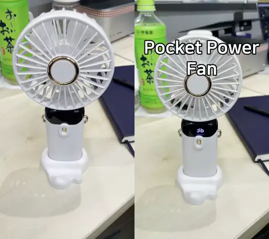
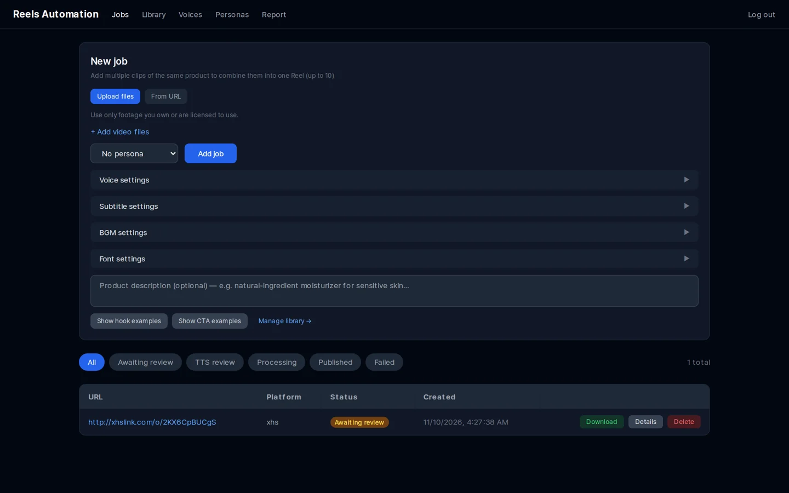
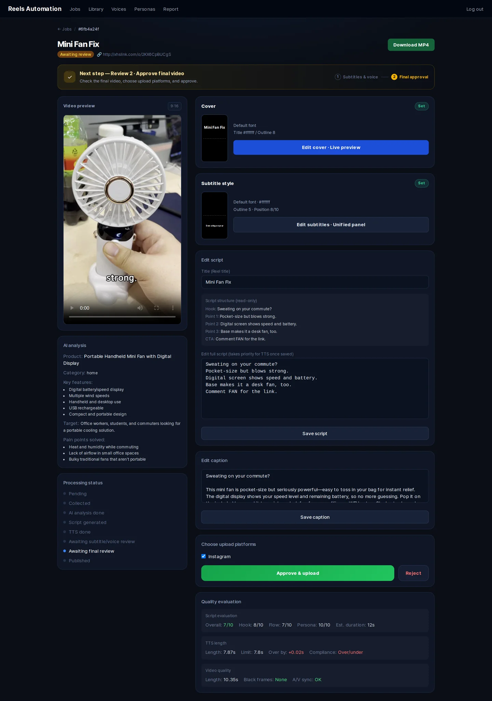

# reels-automation

**English** · [한국어](README.ko.md) · [简体中文](README.zh-CN.md) · [日本語](README.ja.md)

A self-hosted pipeline that turns **your own product footage** into short vertical videos
(Instagram Reels) with an AI-written voice-over script, text-to-speech narration,
styled subtitles and a cover frame. You review everything in a web dashboard before it is
published.

```
Upload footage ─▶ Gemini video analysis ─▶ GPT script ─▶ ElevenLabs TTS ─▶ 540p preview
      │                                                                        │
      │                                   review: edit script, pick cover ◀────┘
      ▼
1080×1920 final render (subtitles, cover, BGM) ─▶ review & approve ─▶ Instagram Reels
```

> [!IMPORTANT]
> This project is a workflow tool for videos made **from footage and audio you own or are
> licensed to use**. It is not intended for — and must not be used for — downloading,
> re-uploading or re-monetising other creators' content. Integrations that access
> third-party platforms are **off by default**. Read [docs/LEGAL.md](docs/LEGAL.md) before
> enabling any of them.

## Demo

A 10-second handheld-fan clip in, a Reel out — default settings, no persona, only the subtitle and
cover style adjusted.

<p align="center">
  
</p>
<p align="center"><sub>Left: original footage (the maintainer's own clip) · Right: generated Reel — cover, AI script, ElevenLabs voice-over, subtitles.</sub></p>

**▶ With sound** (original on the left, generated Reel on the right):

https://github.com/user-attachments/assets/e562431c-fef9-4cae-9344-e789f60f9b30

Script written by GPT from Gemini's analysis of the video:

> **Hook:** Hot commute? Fix it fast.
> **Points:** LED shows speed and battery. · Hold, fold for desk, or wear it. · Strong breeze, quiet, lasts longer.
> **CTA:** Comment FAN for the link.

<details>
<summary>Dashboard screenshots</summary>




</details>

## Features

- **Multiple sources per job** — combine up to 10 clips of the same product into one video.
- **AI script** — hook → 3 key points → call-to-action, timed to the footage length, in any
  language (`CONTENT_LANGUAGE`).
- **Optional personas** — define speaking styles (description + speech style) in the dashboard;
  no persona is applied unless you choose one. Example personas are in [`examples/`](examples).
- **Prompt library** — store hook / CTA / script examples that are injected as few-shot examples.
- **TTS** — ElevenLabs `eleven_v3` with per-job voice, speed and volume.
- **Editing** — moviepy + ffmpeg: subtitles (font, size, colour, stroke, shadow, italic,
  position), cover frame with title, background music with volume control.
- **Two review steps** — preview (540p) with script editing and cover picking, then the final
  render (1080×1920) before upload.
- **Quality evaluation** — non-blocking checks: LLM-as-judge script score, TTS length check,
  black-frame / duration check on the final video.
- **Instagram Reels upload** via the official Instagram API (Instagram Login).

## Requirements

- Docker with Compose v2
- API keys:

| Service | Used for | Required |
|---|---|---|
| [OpenAI](https://platform.openai.com/api-keys) | script, caption, script evaluation | yes |
| [ElevenLabs](https://elevenlabs.io/app/settings/api-keys) | text-to-speech | yes |
| [Google AI Studio (Gemini)](https://aistudio.google.com/app/apikey) | video analysis | optional |
| [Meta for Developers](https://developers.facebook.com) | Instagram Reels upload | optional |

Commercial use of ElevenLabs audio requires a paid ElevenLabs plan. On the Gemini free tier,
Google may use your inputs to improve its products and humans may review them — see
[docs/LEGAL.md](docs/LEGAL.md#ai-providers).

## Quick start

```bash
git clone https://github.com/lazyflog/reels-automation-oss.git
cd reels-automation-oss
cp .env.example .env          # fill in OPENAI_API_KEY, ELEVENLABS_API_KEY, …
python3 scripts/check_env.py  # optional: validate .env

docker compose up -d --build
docker compose exec api alembic upgrade head
docker compose exec api python scripts/create_admin.py --username admin --password '<strong password>'

# optional: load example personas and ElevenLabs voices
docker compose exec api python -m scripts.seed_examples /examples/seed.en.json
```

Open the dashboard at <http://localhost:8080> (nginx) and sign in.

Services: `api` (FastAPI), `worker` and `beat` (Celery), `dashboard` (Next.js), `postgres`,
`redis`, `nginx`.

### Instagram upload

Instagram downloads the rendered video from a public URL, so `PUBLIC_BASE_URL` must be an
HTTPS address that reaches nginx (port 8080) — for local development, e.g. `ngrok http 8080`.
Get a long-lived token with `backend/scripts/instagram_setup.py` (see `--help`).

Meta expects realistic AI-generated audio (such as an AI voice-over) to be labelled as AI
content; apply the label where required. The Content Publishing API is rate-limited (about
100 posts per 24 hours per account).

## Configuration

All settings live in `.env` — see [`.env.example`](.env.example) for the full list.

| Variable | Default | Description |
|---|---|---|
| `CONTENT_LANGUAGE` | `English` | Language of the script, caption and cover title |
| `TARGET_AUDIENCE` | *(empty)* | Optional audience description for the script prompt |
| `CAPTION_DISCLOSURE` | *(empty)* | Text appended to every caption (e.g. an affiliate disclosure) |
| `OPENAI_MODEL` / `GEMINI_MODEL` | `gpt-5.2` / `gemini-3-flash-preview` | Models used |
| `ENABLE_URL_IMPORT` | `true` | Allow importing source videos by URL (yt-dlp) |
| `UPLOAD_DELAY_MIN_MINUTES` / `…_MAX_MINUTES` | `0` / `0` | Optional random delay before upload |

### Opt-in features (off by default)

These exist for users who have the necessary rights, but they carry legal or terms-of-service
risk. Each one logs a warning at start-up when enabled. **Read [docs/LEGAL.md](docs/LEGAL.md)
first.**

| Variable | What it does | Why it is off |
|---|---|---|
| `ENABLE_XHS_IMPORT` | Imports Xiaohongshu links via the third-party [XHS-Downloader](https://github.com/JoeanAmier/XHS-Downloader) sidecar (`docker compose --profile xhs up -d`). | Xiaohongshu's terms prohibit scraping and downloading; XHS-Downloader (GPL-3.0) has its own usage restrictions. |
| `ENABLE_BGM_URL_DOWNLOAD` | Downloads background music from a URL with yt-dlp. | YouTube, SoundCloud and most platforms prohibit downloading audio. |
| `ENABLE_CLOVA_VOICE` | Uses NAVER CLOVA Voice as TTS provider / fallback. | CLOVA Voice's usage policy does not allow saving and editing generated audio. |

## Extending the pipeline

Need to process the source videos before the script is written — for example to clean up or
enhance your own footage? Add a Celery task between `analyze` and `generate`.
[docs/EXTENDING.md](docs/EXTENDING.md) shows how, with an example using the vmake.ai CLI
(video watermark / subtitle removal, video enhancement and more).

## Fonts and music

No fonts or music files are distributed with this repository. The Docker image installs the
Nanum and Noto CJK font families (SIL OFL 1.1). Put additional `.ttf` / `.otf` files in
`backend/fonts/` and audio files in `bgm/` (or upload them in the dashboard) — and check
their licences. See [docs/ASSETS.md](docs/ASSETS.md) for recommended free fonts and music
sources.

## Project layout

```
backend/            FastAPI app, Celery workers, SQLAlchemy models, Alembic migrations
  workers/          extract → analyze → generate → tts → edit → upload
  prompts.py        all LLM prompts (English, output language is configurable)
dashboard/          Next.js 14 dashboard (App Router, Tailwind)
examples/           optional seed data (personas, voices) in English and Korean
nginx/              reverse proxy config
docs/               legal notes, asset guide
```

## Useful commands

```bash
docker compose logs -f worker              # follow worker logs
docker compose up -d --build api worker    # rebuild after backend changes
docker compose exec api alembic upgrade head
docker compose down                        # stop (keeps the database volume)
```

## Contributing

See [CONTRIBUTING.md](CONTRIBUTING.md). Please do not add real third-party video URLs,
creator names, downloaded media or copyrighted audio to issues, tests or examples.

## License

[MIT](LICENSE). Third-party components are listed in
[THIRD_PARTY_NOTICES.md](THIRD_PARTY_NOTICES.md). This software is provided "as is"; you are
solely responsible for how you use it and for complying with the law and with the terms of
every service you connect it to.
