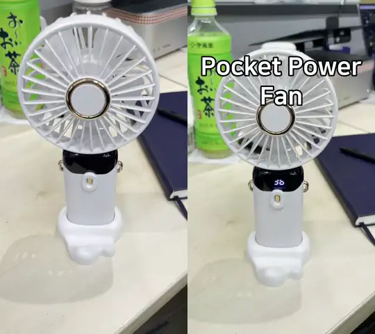
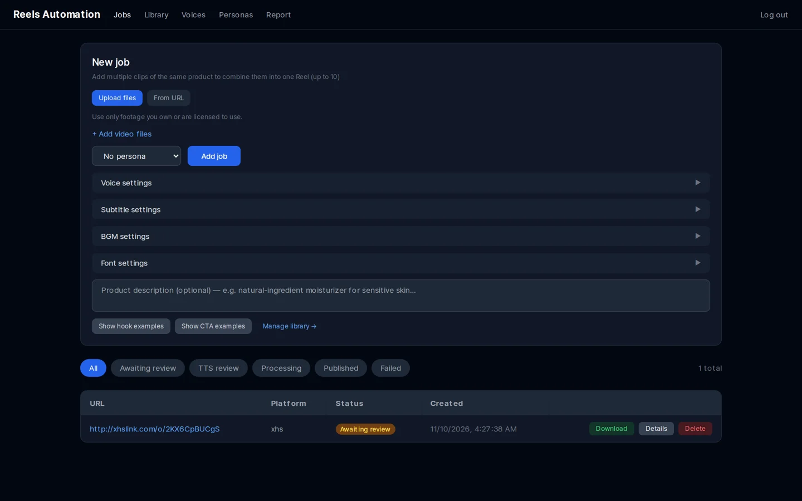
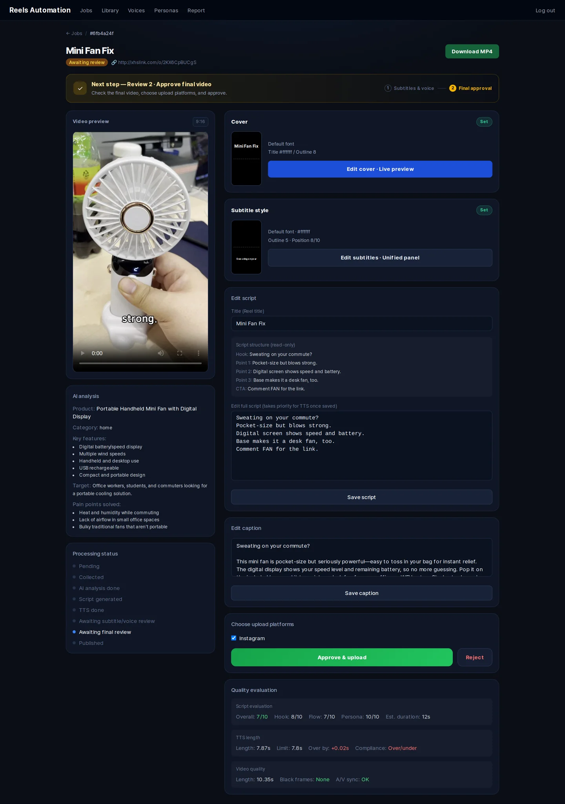

# reels-automation

[English](README.md) · [한국어](README.ko.md) · **简体中文** · [日本語](README.ja.md)

一个可自行部署的流水线，将**你自己的产品素材**制作成竖版短视频（Instagram Reels），
并自动生成 AI 撰写的配音脚本、文字转语音（TTS）旁白、带样式的字幕和封面帧。
所有内容在发布前都会在 Web 控制台中由你审核。

```
Upload footage ─▶ Gemini video analysis ─▶ GPT script ─▶ ElevenLabs TTS ─▶ 540p preview
      │                                                                        │
      │                                   review: edit script, pick cover ◀────┘
      ▼
1080×1920 final render (subtitles, cover, BGM) ─▶ review & approve ─▶ Instagram Reels
```

> [!IMPORTANT]
> 本项目是一款工作流工具，用于以**你拥有或已获授权使用的素材和音频**制作视频。
> 它并非为下载、重新上传他人创作者的内容或以其牟利而设计，也不得用于此类用途。
> 访问第三方平台的集成功能**默认关闭**。启用其中任何一项之前，请先阅读
> [docs/LEGAL.zh-CN.md](docs/LEGAL.zh-CN.md)。

## 演示

输入一段 10 秒的手持风扇视频，输出一条 Reel。使用默认设置、未选择人设，仅调整了字幕和封面样式。

<p align="center">
  
</p>
<p align="center"><sub>左：原始素材（维护者自己拍摄） · 右：生成的 Reel —— 封面、AI 脚本、ElevenLabs 配音、字幕。</sub></p>

**▶ 带声音观看**（左：原始素材，右：生成的 Reel）：

https://github.com/user-attachments/assets/e562431c-fef9-4cae-9344-e789f60f9b30

由 Gemini 分析视频、GPT 撰写的脚本（输出语言：英语）：

> **Hook:** Hot commute? Fix it fast.
> **Points:** LED shows speed and battery. · Hold, fold for desk, or wear it. · Strong breeze, quiet, lasts longer.
> **CTA:** Comment FAN for the link.

<details>
<summary>控制台截图</summary>




</details>

## 功能特性

- **单个任务支持多个素材** —— 可将同一产品的最多 10 段片段合成为一个视频。
- **AI 脚本** —— 按"开场钩子 → 3 个要点 → 行动号召"结构生成，时长与素材匹配，
  支持任意语言（`CONTENT_LANGUAGE`）。
- **可选人设** —— 在控制台中定义说话风格（描述 + 语气）；除非你主动选择，否则不会应用任何人设。
  示例人设见 [`examples/`](examples)。
- **提示词库** —— 保存开场钩子 / CTA / 脚本示例，作为 few-shot 示例注入提示词。
- **TTS** —— 使用 ElevenLabs `eleven_v3`，可按任务设置声音、语速和音量。
- **剪辑** —— 基于 moviepy + ffmpeg：字幕（字体、字号、颜色、描边、阴影、斜体、位置）、
  带标题的封面帧，以及可调音量的背景音乐。
- **两轮审核** —— 先审核预览版（540p），可编辑脚本并选择封面；上传前再审核最终渲染版（1080×1920）。
- **质量评估** —— 非阻塞式检查：以 LLM 作为评审对脚本打分、TTS 时长检查、
  对最终视频进行黑帧 / 时长检查。
- **Instagram Reels 上传** —— 通过官方 Instagram API（Instagram Login）完成。

## 环境要求

- Docker 及 Compose v2
- API 密钥：

| 服务 | 用途 | 是否必需 |
|---|---|---|
| [OpenAI](https://platform.openai.com/api-keys) | 脚本、文案、脚本评估 | 是 |
| [ElevenLabs](https://elevenlabs.io/app/settings/api-keys) | 文字转语音 | 是 |
| [Google AI Studio (Gemini)](https://aistudio.google.com/app/apikey) | 视频分析 | 可选 |
| [Meta for Developers](https://developers.facebook.com) | Instagram Reels 上传 | 可选 |

商业使用 ElevenLabs 生成的音频需要付费的 ElevenLabs 套餐。使用 Gemini 免费层级时，
Google 可能会使用你的输入来改进其产品，并且可能由人工审阅这些内容 —— 详见
[docs/LEGAL.zh-CN.md](docs/LEGAL.zh-CN.md#ai-提供商)。

## 快速开始

```bash
git clone https://github.com/lazyflog/reels-automation-oss.git
cd reels-automation-oss
cp .env.example .env          # 填写 OPENAI_API_KEY、ELEVENLABS_API_KEY 等
python3 scripts/check_env.py  # 可选：校验 .env

docker compose up -d --build
docker compose exec api alembic upgrade head
docker compose exec api python scripts/create_admin.py --username admin --password '<strong password>'

# 可选：导入示例人设和 ElevenLabs 声音
docker compose exec api python -m scripts.seed_examples /examples/seed.en.json
```

在 <http://localhost:8080>（nginx）打开控制台并登录。

服务组成：`api`（FastAPI）、`worker` 和 `beat`（Celery）、`dashboard`（Next.js）、`postgres`、
`redis`、`nginx`。

### Instagram 上传

Instagram 会从公开 URL 下载渲染好的视频，因此 `PUBLIC_BASE_URL` 必须是一个能访问到 nginx
（端口 8080）的 HTTPS 地址 —— 本地开发时可使用例如 `ngrok http 8080`。
使用 `backend/scripts/instagram_setup.py` 获取长期有效的令牌（参见 `--help`）。

Meta 要求将逼真的 AI 生成音频（例如 AI 配音）标注为 AI 内容；请在需要时添加该标注。
Content Publishing API 有调用频率限制（每个账号每 24 小时约 100 条帖子）。

## 配置

所有设置都位于 `.env` 中 —— 完整列表见 [`.env.example`](.env.example)。

| 变量 | 默认值 | 说明 |
|---|---|---|
| `CONTENT_LANGUAGE` | `English` | 脚本、文案和封面标题使用的语言 |
| `TARGET_AUDIENCE` | *（空）* | 可选，用于脚本提示词的目标受众描述 |
| `CAPTION_DISCLOSURE` | *（空）* | 附加到每条文案末尾的文本（例如联盟营销披露声明） |
| `OPENAI_MODEL` / `GEMINI_MODEL` | `gpt-5.2` / `gemini-3-flash-preview` | 所使用的模型 |
| `ENABLE_URL_IMPORT` | `true` | 允许通过 URL 导入源视频（yt-dlp） |
| `UPLOAD_DELAY_MIN_MINUTES` / `…_MAX_MINUTES` | `0` / `0` | 可选，上传前的随机延迟 |

### 需手动启用的功能（默认关闭）

这些功能是为拥有相应权利的用户提供的，但它们存在法律或服务条款方面的风险。
每项功能启用后都会在启动时输出一条警告日志。**请先阅读 [docs/LEGAL.zh-CN.md](docs/LEGAL.zh-CN.md)。**

| 变量 | 作用 | 默认关闭的原因 |
|---|---|---|
| `ENABLE_XHS_IMPORT` | 通过第三方 [XHS-Downloader](https://github.com/JoeanAmier/XHS-Downloader) 边车容器（`docker compose --profile xhs up -d`）导入小红书（Xiaohongshu）链接。 | 小红书的条款禁止抓取和下载；XHS-Downloader（GPL-3.0）也有其自身的使用限制。 |
| `ENABLE_BGM_URL_DOWNLOAD` | 使用 yt-dlp 从 URL 下载背景音乐。 | YouTube、SoundCloud 及大多数平台禁止下载音频。 |
| `ENABLE_CLOVA_VOICE` | 使用 NAVER CLOVA Voice 作为 TTS 提供商 / 备用方案。 | CLOVA Voice 的使用政策不允许保存和编辑生成的音频。 |

## 扩展流水线

需要在生成脚本之前先处理源视频——例如清理或增强你自己的素材？在 `analyze` 和 `generate`
之间添加一个 Celery 任务即可。具体做法见 [docs/EXTENDING.zh-CN.md](docs/EXTENDING.zh-CN.md)，
其中附有使用 vmake.ai CLI（视频水印 / 字幕去除、视频画质增强等）的示例。

## 字体和音乐

本仓库不分发任何字体或音乐文件。Docker 镜像会安装 Nanum 和 Noto CJK 字体系列（SIL OFL 1.1）。
将其他 `.ttf` / `.otf` 文件放入 `backend/fonts/`，将音频文件放入 `bgm/`（或在控制台中上传）——
并请确认它们的许可协议。推荐的免费字体和音乐来源见 [docs/ASSETS.zh-CN.md](docs/ASSETS.zh-CN.md)。

## 项目结构

```
backend/            FastAPI 应用、Celery worker、SQLAlchemy 模型、Alembic 迁移
  workers/          extract → analyze → generate → tts → edit → upload
  prompts.py        所有 LLM 提示词（英文编写，输出语言可配置）
dashboard/          Next.js 14 控制台（App Router、Tailwind）
examples/           可选的种子数据（人设、声音），提供英文和韩文版本
nginx/              反向代理配置
docs/               法律说明、素材指南
```

## 常用命令

```bash
docker compose logs -f worker              # 实时查看 worker 日志
docker compose up -d --build api worker    # 修改后端后重新构建
docker compose exec api alembic upgrade head
docker compose down                        # 停止服务（保留数据库卷）
```

## 参与贡献

参见 [CONTRIBUTING.md](CONTRIBUTING.md)。请勿在 issue、测试或示例中加入真实的第三方视频 URL、
创作者名称、下载的媒体文件或受版权保护的音频。

## 许可证

[MIT](LICENSE)。第三方组件列于 [THIRD_PARTY_NOTICES.md](THIRD_PARTY_NOTICES.md)。
本软件按"原样"提供；你须自行对使用方式承担全部责任，并自行确保遵守法律以及所接入的每项服务的条款。
